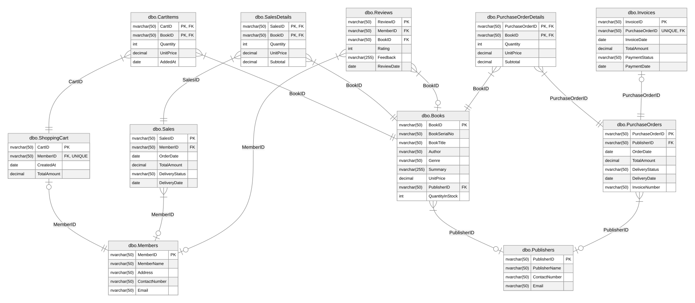

# 📚 E-Bookstore Database System

A relational database system for an **online electronic bookstore (E-Bookstore)**, designed and implemented in Microsoft SQL Server. The system models the full business cycle of an online book retailer: restocking from publishers, member registration and shopping, sales and delivery, reviews, and invoicing.

## 📌 Overview

A bookstore in Kuala Lumpur, Malaysia holds a large collection of books in its warehouse and currently manages procurement, inventory, and sales through manual processes. As the business grows, it wants to **digitalize operations** with a centralized online store, which requires a database to manage books, members, orders, reviews, and the restocking supply chain.

This project designs and implements that **centralized E-Bookstore Database System** — from conceptual data modelling (ER design) through to a working SQL Server schema with sample data and queries that answer real business questions. A single database centralizes all book, publisher, member, order, and review data, reducing duplication, enforcing data integrity through constraints, and giving the bookstore accurate, up-to-date information for day-to-day operations and decision-making.

## 🎯 Objectives

- Design a normalized relational schema for an online bookstore.
- Model the business domain with an Entity Relationship Diagram.
- Implement the schema in Microsoft SQL Server (DDL with primary/foreign keys and constraints).
- Populate the database with realistic sample data.
- Provide queries that demonstrate joins, aggregation, subqueries, and filtering against the schema.

## 🧩 How It Works

- The bookstore purchases books from **publishers** and sells them to **members**. The store manager compiles a list of needed books and sends a **purchase order** to publishers; the publisher supplies the ordered books.
- Arriving books are recorded, and an **invoice** is generated for the accounts department to process payment.
- Customers must **register as members** before buying online. Members can view book information and read reviews.
- Members add books to a **shopping cart** that shows the selection summary and total cost. After payment, books are delivered within **7 working days**.
- A member can **review** a book with a rating (1–10, where 1 = terrible and 10 = masterpiece) and optional short text. Only **one review per member per book** is allowed, and reviews cannot be edited once submitted.

## 📏 Business Rules

The schema enforces the following key rules through primary keys, foreign keys, and constraints:

**Integrity**
- Every table has a unique, non-null primary key (`BookID`, `MemberID`, `PublisherID`, etc.), and all foreign keys are enforced to prevent orphan records.
- `Email` is unique for both publishers and members.
- A book's `UnitPrice` cannot be zero or negative, and mandatory book fields (serial number, title, author, genre) must be filled.

**Publishers & Books**
- A publisher can publish many books and receive many purchase orders; each book belongs to exactly one publisher.
- A book can appear in many sales and shopping carts and receive many reviews.

**Members, Cart & Sales**
- A customer must register as a member before purchasing. Each member owns at most **one shopping cart** at a time, and a cart cannot contain duplicate entries for the same book.
- A member can place many sales orders, but each sale belongs to exactly one member, and a sale's total must equal the sum of its line items.
- Delivery is promised within **7 working days**; `DeliveryDate` stays `NULL` until `DeliveryStatus` becomes `Delivered`.

**Reviews**
- Ratings must be between **1 and 10**; feedback text is optional.
- A member can review a given book **only once**, and reviews cannot be changed after submission.

**Purchase Orders & Invoices**
- A purchase order is linked to exactly one publisher and one invoice, and may contain multiple books.
- An invoice cannot exist without a purchase order; `PaymentDate` stays `NULL` until the invoice is marked `Paid`.

## 🛠️ Tech Stack

- **Microsoft SQL Server** — relational database engine
- **Docker** — containerized SQL Server instance
- **Azure Data Studio** — SQL development and query execution
- **T-SQL** — schema definition (DDL), sample data, and queries (DML)

## 🗺️ Database Design

### Entity Relationship Diagram (ERD)

The conceptual model showing the entities and the relationships between them.

### Database Schema

The physical schema as implemented in SQL Server — tables, columns, primary keys, and foreign keys.

### Entities

| Table | Description |
|---|---|
| `Publishers` | Publishers that supply books to the store. |
| `Books` | Book catalogue: title, author, genre, price, and stock quantity. |
| `Members` | Registered customers who can shop and review. |
| `ShoppingCart` | A member's active cart. |
| `CartItems` | Line items (books and quantities) within a shopping cart. |
| `Sales` | Member orders. |
| `SalesDetails` | Line items for each sale. |
| `Reviews` | Member ratings and feedback on books (one per member per book). |
| `PurchaseOrders` | Orders the store sends to publishers to restock. |
| `PurchaseOrderDetails` | Line items for each purchase order. |
| `Invoices` | Invoices generated from purchase orders. |

## 🚀 Usage

The entire database is defined in a single script, [`E-Bookstore Database System.sql`](E-Bookstore%20Database%20System.sql). Running it in Microsoft SQL Server will, in order:

1. Create the `ebookstore` database.
2. Create all 11 tables with their keys and constraints.
3. Insert the sample data.
4. Run the example queries described below.

## 🔍 Example Queries

The script includes queries that answer business questions such as:

- Total number of reviews (feedback) per book — book ID, title, and count.
- Total number of reviews per member — member ID, name, and count.
- Number of books published by each publisher.
- Number of books in each genre.
- Books with stock quantity above the average of all books.
- Total number of books ordered by the store manager from publishers.
- Members who have not placed any order.
- The genre with the highest total quantity in stock.
- Purchased books not yet delivered — member ID, address, contact number, book serial number, title, quantity, order date, and delivery status.
- Members who placed more than two orders.

These demonstrate common SQL patterns — `JOIN`, `GROUP BY`, `HAVING`, aggregate functions, and subqueries.

## ⚠️ Notes & Limitations

- The database is populated with a small set of synthetic sample data to demonstrate the schema and queries, not real transaction volumes.
- The design focuses on the core retail/supply-chain domain. A production deployment would add security hardening, indexing strategy, payment-gateway integration, and concurrency handling.

## 🗄️ Repository Contents

- `E-Bookstore Database System.sql` — complete SQL script: database creation, all tables, sample data, and example queries.
- `ERD diagram.png` — Entity Relationship Diagram (conceptual model of entities and relationships).
- `final.svg` — database schema diagram (physical tables, columns, and keys).
- `README.md` — project documentation.
- `LICENSE` — license terms for this repository.

## 👤 Author

**Chin Mun Qin**
